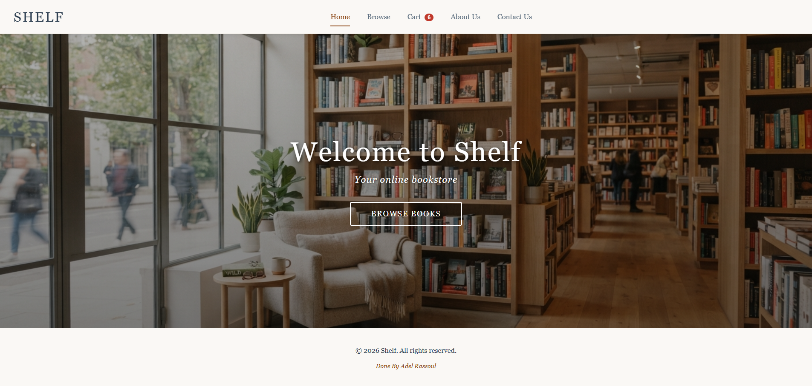
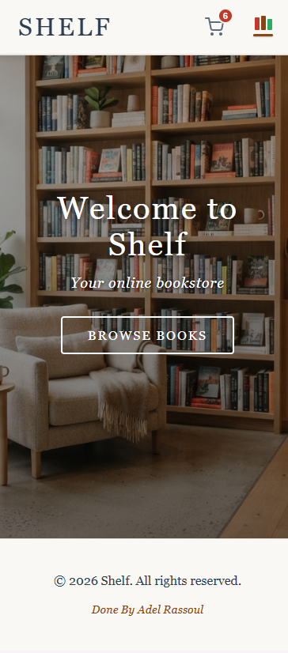
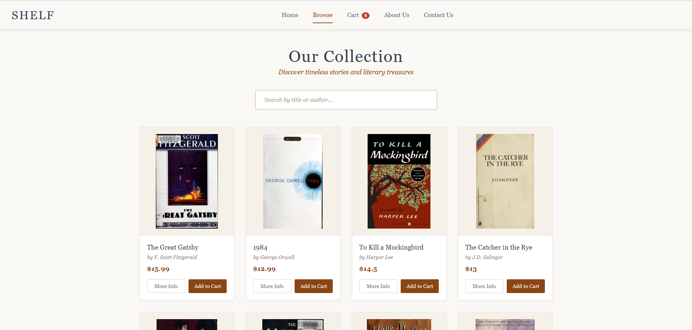
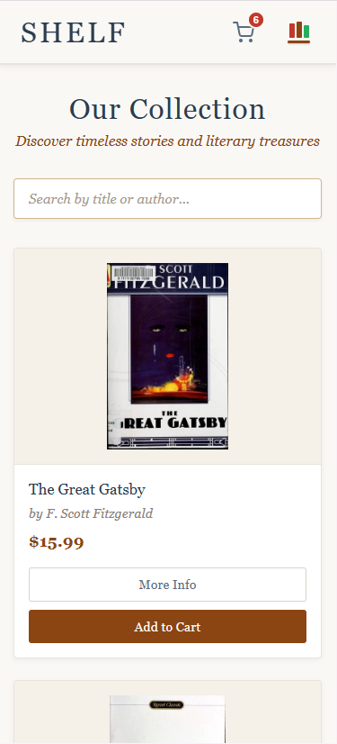
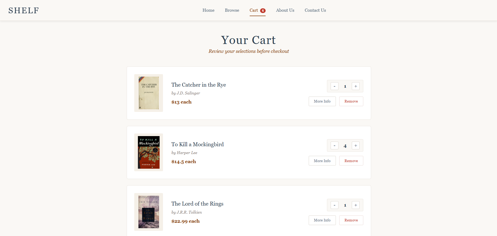
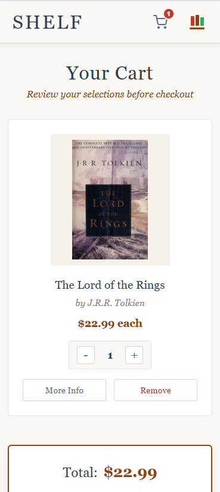
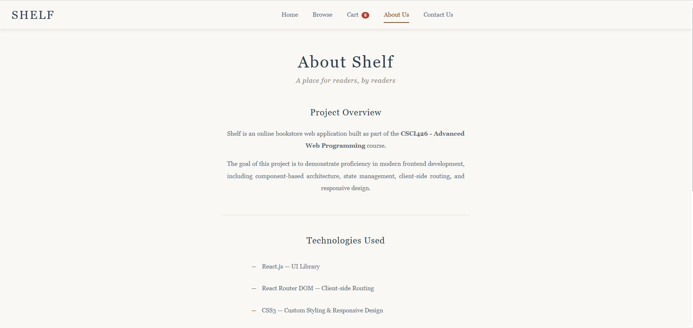
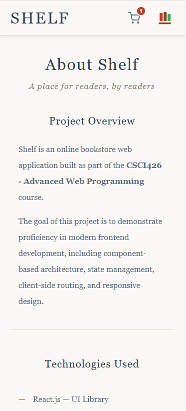
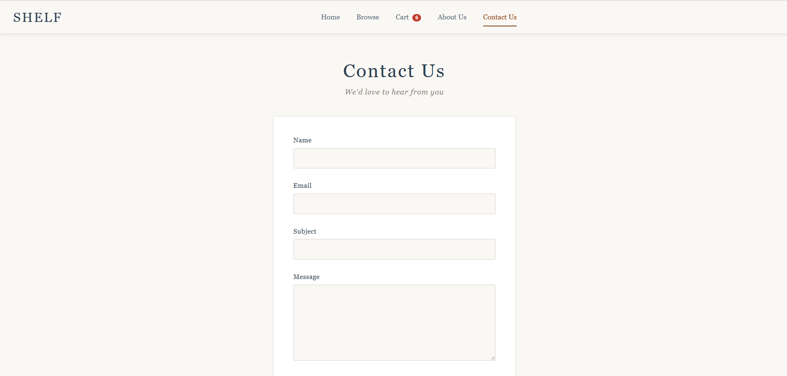
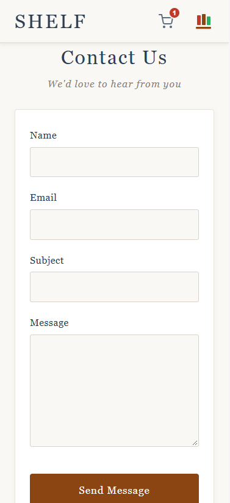

# Shelf — Online Bookstore

A responsive frontend web application for browsing and purchasing books, developed
for CSCI426: Advanced Web Programming (Project Phase 1).

## Overview

Shelf is a client-side online bookstore built with React. Users can browse a catalog
of 50 titles, search by title or author, view detailed book information, and manage a
shopping cart that persists across page refreshes.

The project focuses on component-based architecture, client-side routing, state
management, and responsive UI/UX design. All data is stored locally in the browser;
no backend or payment processing is involved, and checkout is simulated.

## Features

- **Book catalog** — 50 titles with cover images, loaded from a local JSON dataset
- **Search** — real-time filtering by title or author
- **Pagination** — 12 books per page with previous/next navigation
- **Book details** — modal overlay with description, author, and price
- **Shopping cart** — add items, adjust quantities, remove items, live total calculation
- **Cart persistence** — cart state saved to `localStorage` via `useEffect`
- **Contact form** — controlled form with a single change handler and email validation
- **Feedback messages** — non-blocking toast notifications for cart and form actions
- **Responsive layout** — desktop, tablet, and mobile breakpoints, with a dedicated
  mobile cart indicator and collapsible navigation

## Technologies

| Technology | Purpose |
| --- | --- |
| React 18 | Component-based UI and state management |
| React Router DOM | Client-side routing |
| CSS3 | Custom styling, Flexbox/Grid, media queries |
| Web Storage API | Cart persistence in `localStorage` |
| Open Library Covers API | Book cover images |
| Git / GitHub | Version control and hosting |

## Getting Started

### Prerequisites

- Node.js 16 or later
- npm

### Installation

```bash
git clone https://github.com/<your-username>/<repo-name>.git
cd <repo-name>
npm install
```

### Development

```bash
npm start
```

Runs the app at `http://localhost:3000`.

### Production build

```bash
npm run build
```

Outputs an optimized build to the `build/` directory.

## Project Structure

```
src/
├── components/
│   ├── BookCard.jsx          # Book preview card
│   ├── BookOverlay.jsx       # Book details modal
│   ├── Navbar.jsx            # Navigation and cart indicator
│   └── Footer.jsx
├── context/
│   └── ActivePageContext.js  # Tracks the active route for nav highlighting
├── data/
│   └── books.json            # Book catalog (50 entries)
├── pages/
│   ├── Home.jsx
│   ├── Browse.jsx            # Search, pagination, catalog grid
│   ├── Cart.jsx              # Cart items and quantity controls
│   ├── About.jsx
│   └── Contact.jsx           # Controlled form with validation
├── styles/                   # One stylesheet per component/page
├── App.js                    # Routes, cart state, toast messages
└── index.js
```

## Pages

| Route | Page | Description |
| --- | --- | --- |
| `/` | Home | Landing page |
| `/browse` | Browse | Searchable, paginated catalog |
| `/cart` | Cart | Cart management and checkout |
| `/about` | About | Project and technical overview |
| `/contact` | Contact | Validated contact form |

## Implementation Notes

- **Cart state** lives in `App.js` and is passed down as props. Adding an existing
  title increments its quantity rather than creating a duplicate entry.
- **Persistence** is handled by a `useEffect` hook that writes the cart to
  `localStorage` whenever it changes, and a lazy `useState` initializer that reads it
  back on load.
- **Active navigation** is shared through `ActivePageContext` so the navbar can
  highlight the current page without prop drilling.
- **Form handling** uses a single state object and one `handleChange` function keyed
  by each input's `name` attribute.

## Screenshots

Screenshots are stored in the `screenshots/` directory.


| Desktop View | Mobile View |
| --- | --- |
|  |  |
|  |  |
|  |  |
|  |  |
|  |  |

## Deployment

The application is deployed and accessible at:  
🔗 **https://shelf-rho-three.vercel.app**

## Course Information

- **Course:** CSCI426 — Advanced Web Programming
- **Department:** Computer Science and Information Technology
- **Phase:** 1 — Frontend Development
- **Author:** `Adel Rassoul` (`12133700`)